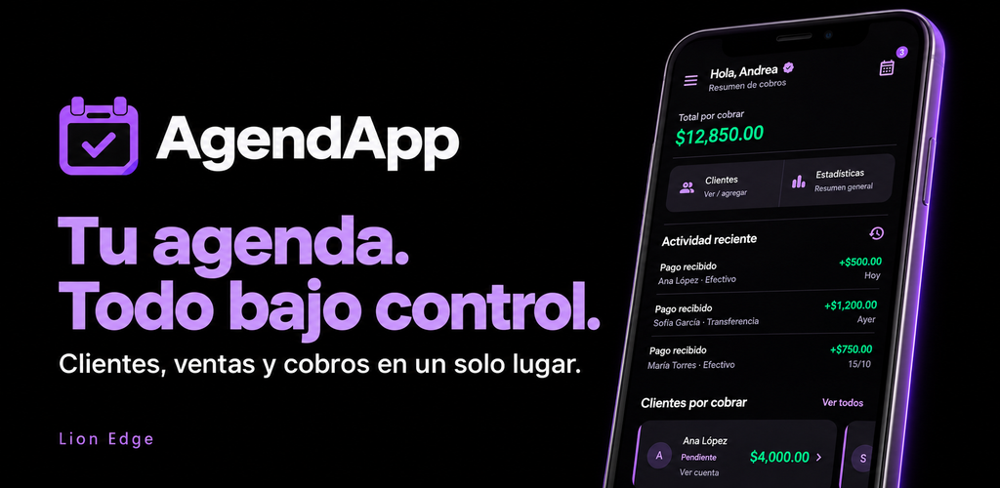
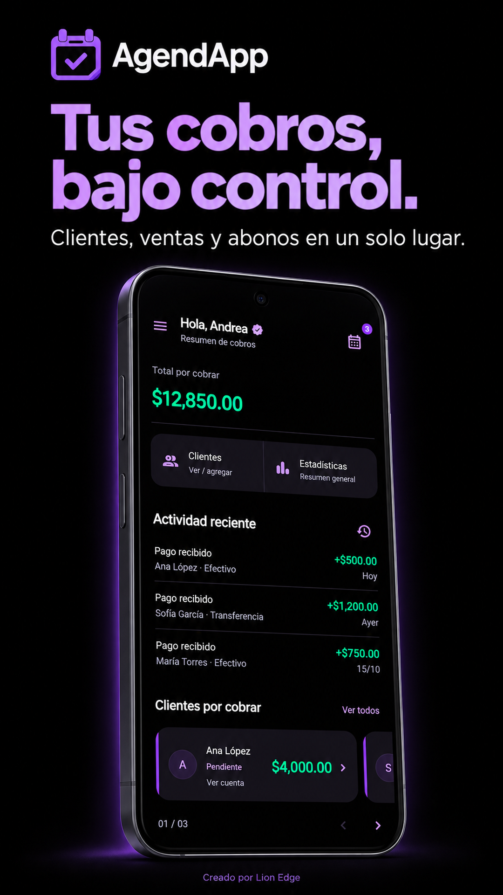
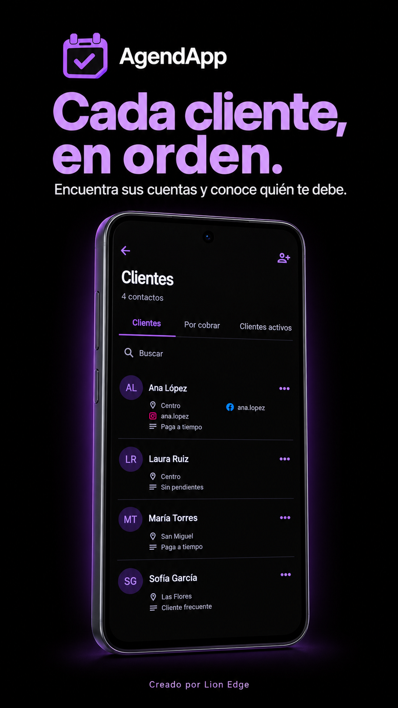
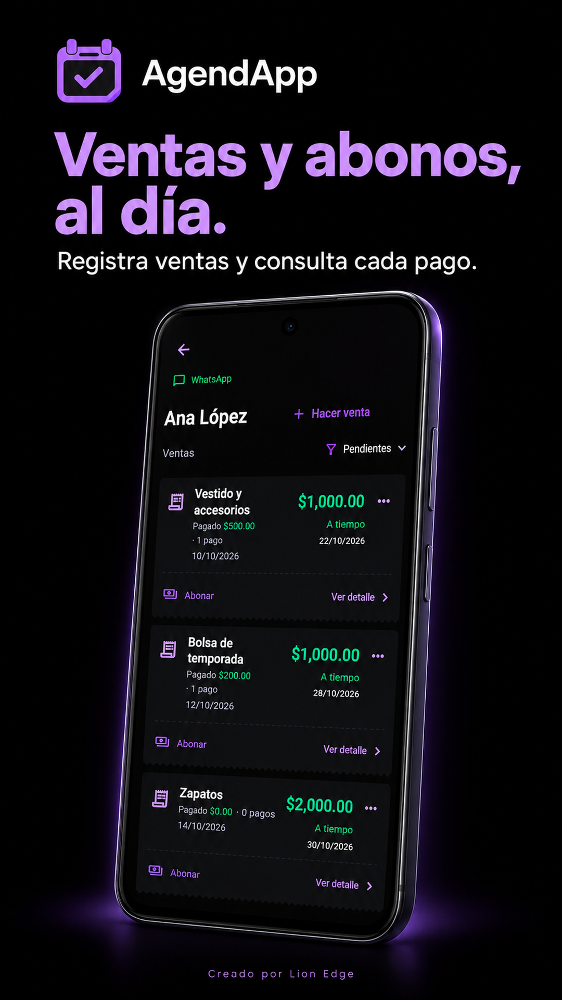
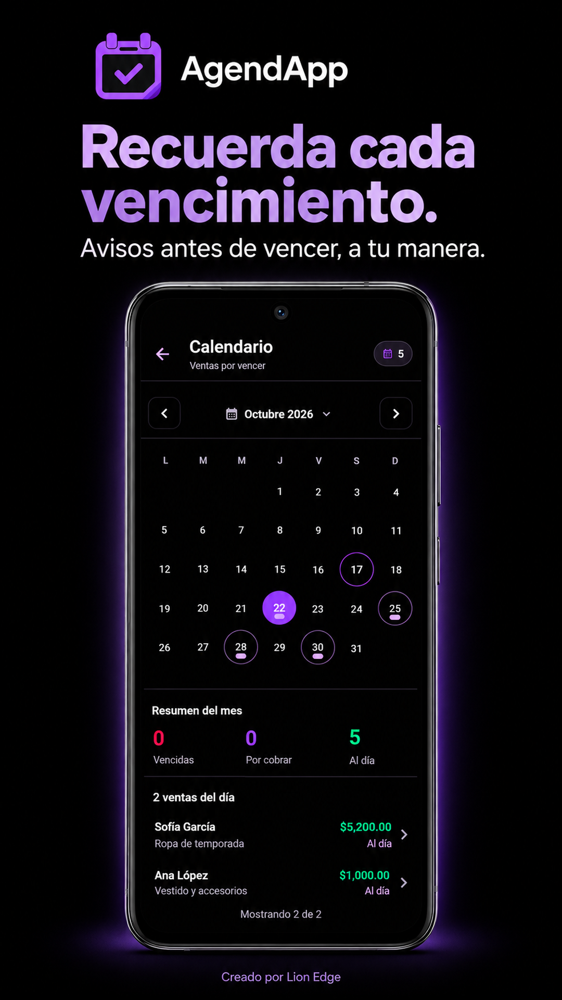
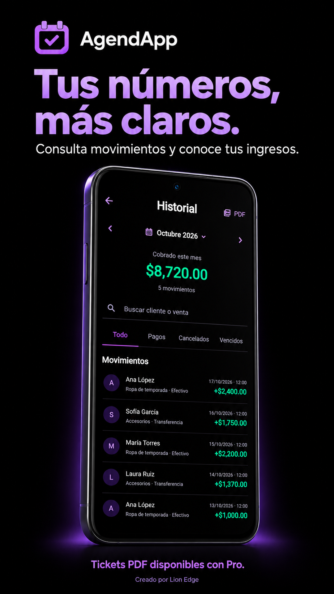
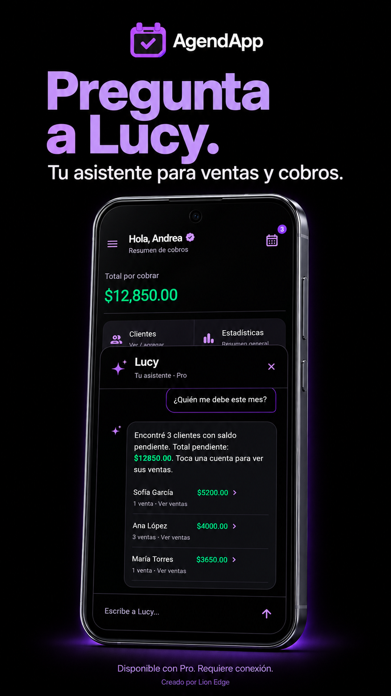

# AgendApp

**Tu agenda. Todo bajo control.**

Aplicación para Android que ayuda a organizar clientes, ventas, abonos y cuentas pendientes en un solo lugar. Pensada para pequeños negocios, ventas por catálogo y personas que cobran a plazos.

Desarrollada por **Kevin · LionEdge**, con una interfaz minimalista negra y morada y saldos destacados en verde.

## Disponible en Google Play

La actualización **1.0.4** fue enviada a revisión. La ficha puede mostrar la versión anterior hasta que Google apruebe y publique la actualización.

## Qué permite hacer

| Apartado | Funciones |
| --- | --- |
| Clientes | Registrar contactos, buscar clientes y consultar sus cuentas y ventas. |
| Ventas y abonos | Crear ventas, definir vencimientos y registrar pagos con su método de cobro. |
| Por cobrar | Consultar saldos pendientes y ver cómo disminuyen al registrar abonos. |
| Calendario | Revisar vencimientos y ventas por día. |
| Recordatorios | Configurar varios avisos antes del vencimiento en Android, con permiso de notificaciones. |
| Historial | Consultar movimientos por período y conservar el registro de ingresos aunque se elimine una venta o un cliente. |
| Estadísticas | Consultar los ingresos del mes y su evolución. |
| Cuenta | Iniciar sesión con correo o Google y recuperar los datos asociados a la cuenta. |

## AgendApp Pro

El plan Pro incorpora **tickets PDF para descargar o compartir** y **Lucy**, la asistente integrada para consultas sobre la app, pendientes, ingresos y próximos vencimientos.

Lucy permite consultar cuentas y preparar abonos, que requieren confirmación antes de registrarse. Su conversación utiliza Gemini mediante Firebase AI Logic y necesita conexión a Internet; la disponibilidad está sujeta a la cuota del servicio.

La contratación y el precio del plan se consultan dentro de la aplicación mediante Google Play.

## Un vistazo a la app

Las imágenes muestran la interfaz renovada con datos de demostración.

<table>
  <tr>
    <td></td>
    <td></td>
    <td></td>
  </tr>
  <tr>
    <td></td>
    <td></td>
    <td></td>
  </tr>
</table>

## Tecnologías utilizadas

| Tecnología | Uso en el proyecto |
| --- | --- |
| **Dart** | Lenguaje principal para la lógica y las pantallas de la aplicación. |
| **Flutter** | Interfaz, navegación, componentes y animaciones. |
| **Firebase Authentication y Google Sign-In** | Acceso con cuenta y autenticación. |
| **Cloud Firestore y Firebase Storage** | Almacenamiento en la nube y recursos de la aplicación. |
| **Firebase AI Logic · Gemini** | Conversación y comprensión de consultas en Lucy. |
| **Firebase App Check · Play Integrity** | Verificación de la aplicación Android para los servicios protegidos. |
| **Google Play Billing** | Compras del plan Pro dentro de la app. |
| **flutter_local_notifications** | Recordatorios locales de vencimiento en Android. |
| **pdf y share_plus** | Generación de tickets PDF y opciones para compartir. |
| **intl** | Formato de fechas, cantidades y moneda. |

## Sobre este repositorio

Este es el repositorio público de **presentación y portafolio** de AgendApp. Contiene documentación e imágenes; el código fuente de la aplicación se mantiene privado. No incluye APK, AAB ni credenciales. La instalación se realiza desde Google Play.

## Contacto

**LionEdge · Kevin**  
[Soporte de AgendApp](mailto:Agendappsoporte@hotmail.com)

© 2026 LionEdge. Todos los derechos reservados sobre la marca y los materiales del proyecto.
